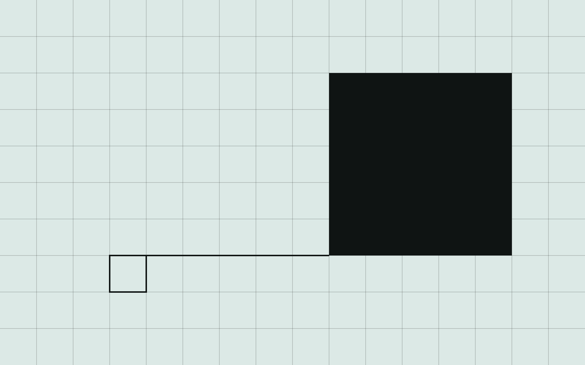

###### Markdown in, deck out

# dex

Write a talk as one Markdown file and present it from the browser. This deck is its own manual: press m on any slide to see the Markdown behind it.

<!-- The title slide. An eyebrow line (six #), one # heading, and a short paragraph make a title slide with no layout syntax. Press m to see this slide's Markdown, and m again to close it. -->

---

Write the words. The layout follows.

<!-- A statement. One short paragraph and no heading is set in very large type. Nothing on this slide says "statement"; dex reads it from what the slide contains. -->

---

# How slides work

<!-- A section divider. A # heading on its own, anywhere after the first slide, becomes a numbered section. -->

---

## Lists that build

+ Write a list with plus signs and it appears one item at a time
+ Press → or Space to show the next item
+ Lists written with - or * appear all at once

<!-- Builds. Each plus item is one step. Press ← to step back. Builds can be turned off for the whole deck in the settings (press s). -->

---

## What happens when you save

1. The file is split into slides at every line of three dashes
2. Comments are read
   - a comment of key and value pairs sets options for its slide
   - any other comment becomes a speaker note
3. The layout is chosen from what is left on the slide
4. The open deck updates in place, without losing your place

<!-- A numbered list with a nested list. Nested items appear with their parent. This note is a speaker note, shown only in the presenter window (press p). -->

---

## Two themes and a switch

### Paper

A pale mint page with near-black ink, for rooms with the lights on. Press t to switch.

### Ink

The same palette turned around, for dark rooms. Put `theme: ink` in the frontmatter to start there.

### Invert

A comment of `invert: true` on a slide shows that one slide in the other theme.

<!-- Columns from ### headings. Two to six of them on one slide make one column each. -->

---

## Columns, two ways

Start each column with a ### heading, as on the last slide. Two to six of them make columns.

|||

Or put a line of three pipes between blocks of text. Each block becomes a column.

<!-- Columns from a column break. A line of three pipes splits the content into columns. -->

---

## An image beside the text

One image and some text split the slide in half. Put the image after the text and it goes on the right.


<!-- A split slide with the image on the right, because the image comes last in the source. Images live in the deck's folder; this one is media/plate-1.svg. -->

---

<!-- fit: contain -->


## Or on the left

Put the image first and it goes on the left. A `fit: contain` comment shows the whole image instead of cropping it to fill.

<!-- A split slide with the image on the left, contained rather than cropped by the fit directive at the top of the slide. -->

---

## A heading and one image make a figure


<!-- A figure. A heading plus a single image puts the title on top and lets the image fill the rest. The text in quotes after the path is the caption. -->

---



<!-- A full-bleed image. One image alone covers the whole screen, and its quoted title becomes the caption. -->

---

## Two or more images make a gallery


<!-- A gallery. Images and nothing else, with an optional heading, are laid out in a grid. -->

---

> Simplicity is about subtracting the obvious and adding the meaningful.
>
> — John Maeda

<!-- A quote slide. A blockquote on its own, and a last line starting with a dash is the attribution. -->

---

23

slides in this deck, all in one Markdown file

<!-- A big number. A first paragraph of eight characters or fewer becomes a giant figure, and the second paragraph its label. -->

---

## Highlight the lines that matter

Put line numbers in braces after the language: `` ```ts {3,5} ``.

```ts {3,5}
// Compile a deck and list its slides.
const source = await readFile('decks/demo/deck.md', 'utf8');
const deck = await compileDeck(source, { slug: 'demo' });
for (const slide of deck.slides) {
  console.log(slide.index + 1, slide.layout, slide.title ?? 'untitled');
}
```

<!-- A code block with highlighted lines. The other lines dim so the audience knows where to look. Code blocks are highlighted for most common languages. -->

---

## Layouts at a glance

| The slide contains | Layout |
|---|---|
| A # heading and a short paragraph | title |
| One short paragraph, no heading | statement |
| One image and some text | split |
| A heading and one image | figure |
| Two to six ### headings | columns |
| Only a blockquote | quote |

<!-- A table. Header cells are set in small mono capitals, with hairlines between rows. When the inferred layout is not what you want, a layout comment overrides it. -->

---

## One thought at a time

Some points need a moment to land.

. . .

A line of three spaced dots is a pause.

. . .

Everything after it waits for the next press.

<!-- Pauses. Each line of three spaced dots holds back the rest of the slide for one more step. -->

---

<!-- invert: true -->

One comment turns a single slide around.

<!-- An inverted slide. The invert directive shows this one slide in the other theme, and the bars follow it. -->

---

<!-- bg: media/plate-4.svg -->

## A picture behind the words

A bg comment puts an image behind the slide, under a dark scrim, and switches the slide to Ink. It takes a CSS colour too.

<!-- A background image. The bg directive takes an image path or a CSS colour. -->

---

## Sources go in footnotes

Every slide is laid out on a fixed canvas of 1600 by 900 points and scaled to fit the screen.[^stage]

[^stage]: That is why drawings, sticky notes, zoom, and the PDF all line up with the slide.

<!-- A footnote. The definition must sit on the same slide as its reference, and it is shown at the bottom of the slide. -->

---

<!-- skip: true -->

## A skipped slide

Presenting goes straight past this slide. It stays in the overview, dimmed, for the question you might get.

<!-- A skipped slide. The skip directive leaves it out of the talk without deleting it. Press g for the overview and pick it to show it anyway. -->

---

## Fourteen bullets is too many

- This slide does not fit at full size, so the type steps down until it does
- The second bullet adds a qualification that nobody in the room asked for
- The third bullet repeats the first one in slightly different words
- The fourth bullet introduces an acronym that is never explained again
- The fifth bullet is a full sentence that should have been a paragraph
- The sixth bullet quotes a statistic without saying where it came from
- The seventh bullet is where most of the audience stops reading
- The eighth bullet contradicts the second one, but only a little
- The ninth bullet lists three examples when one would have done
- The tenth bullet was added the night before by someone else
- The eleventh bullet refers to a chart that is on a different slide
- The twelfth bullet says the same thing as the title of the slide
- The thirteenth bullet promises that the next slide will explain everything
- The fourteenth bullet is finally the point the slide was trying to make

<!-- Too much text. When a slide overflows, dex sets its type smaller, in two steps, until it fits. If it still does not fit, the dev server flags it with OVERFLOW. -->

---

# Your turn

Run `pnpm new my-talk`, open `decks/my-talk/deck.md` in your editor, and start writing. Press s for settings and the full list of keys.

<!-- A closing title slide. A # heading with a short paragraph is a title slide at the end of a deck too. -->
