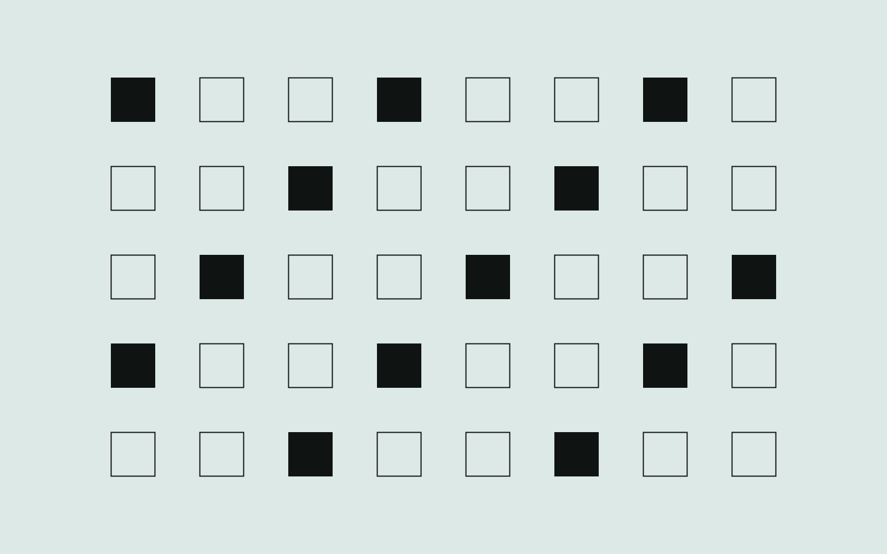
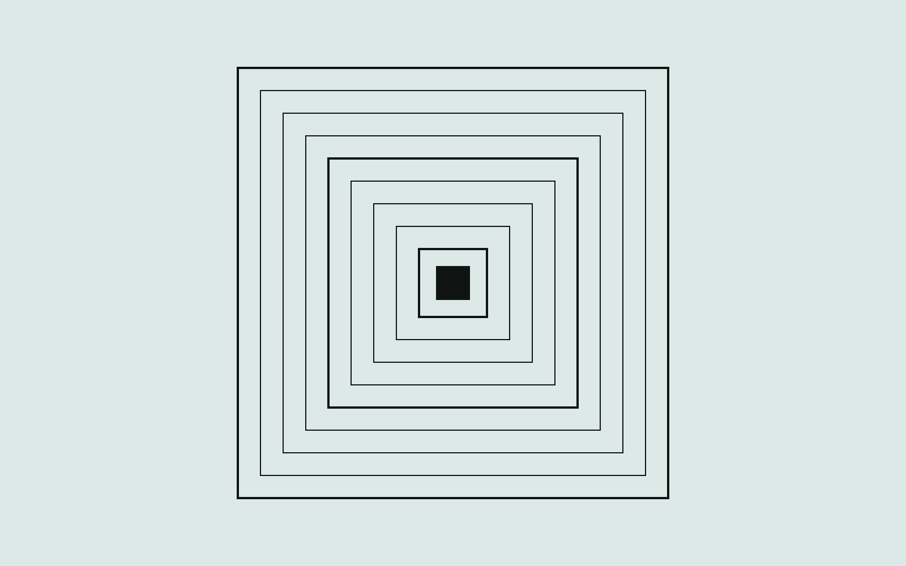
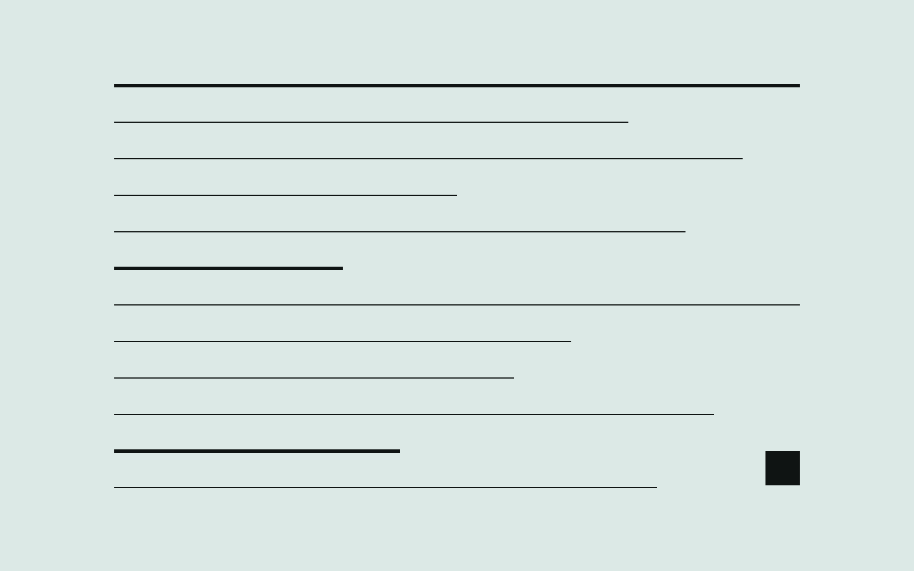

###### dex · demo deck

# Markdown in, deck out

A kitchen-sink deck that shows every layout the compiler can infer, written in plain Markdown.

<!-- The title slide. An eyebrow, one display heading, and a lede add up to the title layout with no directive. -->

---

Write the slide. The layout takes care of itself.

<!-- A statement slide. One short paragraph and no heading becomes very large type. -->

---

# Layouts

<!-- A section divider. A display heading on its own, anywhere but the first slide, becomes a numbered section. -->

---

## Three habits of a good slide

+ Say one thing
+ Show it as plainly as you can
+ Stop before the audience does

<!-- Builds. A list written with plus bullets reveals one item per step. -->

---

## How a slide is built

1. Split the file at every line that is only three dashes
2. Read the comments
   - directives set the slide's options
   - everything else becomes a speaker note
3. Infer the layout from what is left
4. Render the HTML and highlight the code

<!-- A numbered list with a nested list. The nested items appear with their parent. -->

---

## Two themes and a switch

### Paper

A pale mint surface with near-black ink, for rooms with the lights on.

### Ink

The same palette turned around, for dark rooms and late sessions.

### Invert

One directive flips a single slide into the other theme.

<!-- Columns from third-level headings. Each heading starts a column. -->

---

## Before and after

Bullets that fill the slide, a title that says nothing, and a logo in every corner.

|||

One idea per slide, a title that makes the point, and room around it to breathe.

<!-- Columns from a column break. A line of three pipes splits the content into columns. -->

---

## Images sit beside the text

When a slide has one image and some text, the image takes half of the canvas. Put the image last and it goes on the right.



<!-- A split slide with the image on the right, because the image comes last in the source. -->

---

<!-- fit: contain -->



## Or on the left

Put the image first and it takes the left half. The fit directive keeps the whole image in view instead of cropping it.

<!-- A split slide with the image on the left, contained rather than cropped. -->

---

## A figure is a title and one image



<!-- A figure slide. A heading plus a single image puts the title on top and lets the image fill the rest. -->

---


<!-- A full-bleed image. One image alone covers the stage, and its quoted title becomes the caption. -->

---


<!-- A gallery. Three images and nothing else are laid out in a grid. -->

---

> Simplicity is about subtracting the obvious and adding the meaningful.
>
> — John Maeda

<!-- A quote slide. A blockquote on its own, with the last line taken as the attribution. -->

---

23

slides in this deck, all in one Markdown file

<!-- A big number. A first paragraph of eight characters or fewer becomes a giant figure, and the second paragraph its label. -->

---

## Highlight the lines that matter

```ts {2,4-5}
export async function compileDeck(source: string, opts: { slug: string }) {
  const { meta, body } = parseFrontmatter(source);
  const chunks = splitSlides(body);
  const slides = await Promise.all(chunks.map(compileChunk));
  return { slug: opts.slug, meta, slides };
}
```

<!-- A code block with highlighted lines. The braces after the language pick lines two, four, and five. -->

---

## Layouts at a glance

| The slide contains | Layout |
|---|---|
| A display heading and a lede | title |
| One short paragraph | statement |
| One image and some text | split |
| Two or more third-level headings | columns |
| Only a blockquote | quote |

<!-- A table. Header cells are set in small mono capitals, with hairlines between rows. -->

---

## One thought at a time

A paragraph can wait its turn.

. . .

A line of three spaced dots is a pause.

. . .

Everything after it appears on the next step.

<!-- Pauses. Each line of three spaced dots holds back the rest of the slide for one more step. -->

---

<!-- invert: true -->

This slide is shown in the other theme.

<!-- An inverted slide. The invert directive flips this one slide, and the bars follow it. -->

---

<!-- bg: media/plate-4.svg -->

## Background images

A bg directive puts an image behind the slide, under a dark scrim, and switches the slide to Ink.

<!-- A background image slide. The bg directive takes an image path or a CSS color. -->

---

## Sources go in footnotes

The stage is a fixed canvas of 1600 by 900 logical pixels, scaled to fit the window.[^stage]

[^stage]: Fixed coordinates are what make zoom, drawing, sticky notes, and print line up exactly.

<!-- A footnote. The definition must sit on the same slide as its reference, and it renders at the bottom. -->

---

<!-- skip: true -->

## A hidden slide

This slide stays in the overview, dimmed, but presenting skips right past it.

<!-- A skipped slide. The skip directive leaves it out of the presentation without deleting it. -->

---

## Fourteen bullets is too many

- The first bullet sets up the topic and promises that the rest will be brief
- The second bullet adds a qualification that nobody in the room asked for
- The third bullet repeats the first one in slightly different words
- The fourth bullet introduces an acronym that is never explained again
- The fifth bullet is a full sentence that should have been a paragraph
- The sixth bullet quotes a statistic without saying where it came from
- The seventh bullet is where most of the audience stops reading
- The eighth bullet contradicts the second one, but only a little
- The ninth bullet lists three examples when one would have done
- The tenth bullet was added the night before by someone else
- The eleventh bullet refers to a chart that is on a different slide
- The twelfth bullet says the same thing as the title of the slide
- The thirteenth bullet promises that the next slide will explain everything
- The fourteenth bullet is finally the point the slide was trying to make

<!-- An overflow stress test. Fourteen long bullets do not fit, so the runtime steps the density down until they do. -->

---

# Thank you

Edit this deck in decks/demo/deck.md and save. The open deck updates in place.

<!-- A closing title slide. A display heading with a lede is a title layout at the end of the deck too. -->
