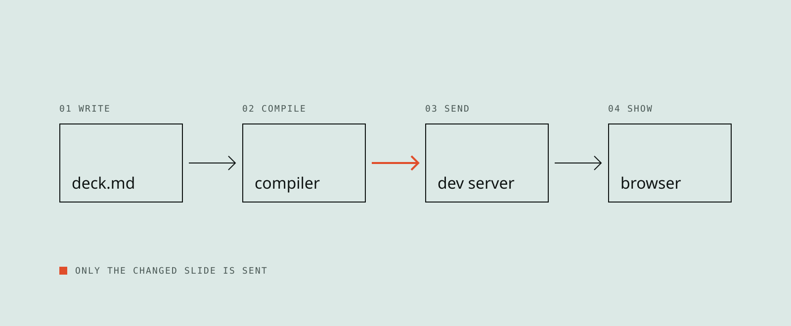

# Images that match the deck

A dex slide is quiet: pale mint paper, near-black ink, hairlines, squares, two typefaces, a lot of empty space. An image made somewhere else usually brings its own colours, rounded corners, and shadows, and looks pasted in. This guide describes the look, gives the sizes to draw at, and has two prompts you can paste into an assistant or an image generator to get a diagram or illustration that belongs on the slide.

The four plates in `decks/demo/media/` follow it, and so does this diagram:



## The look

- **A plate on the page.** The image has its own flat ground, slightly darker than the slide, running to all four edges. Nothing is transparent.
- **Squares and straight lines.** Rectangles, grids, and horizontal or vertical lines. Square corners and square line ends.
- **Outline or solid.** A shape is an outline with no fill, or solid ink.
- **One emphasis.** Solid ink marks the one shape the slide is about. Orange-red marks the one line: a link, a path, a measurement. Use one of the two, once.
- **Few words.** The slide's heading and caption do the explaining. Labels in the picture are names and numbers.
- **Never** rounded corners, shadows, gradients, textures, 3D, icons, emoji, or a third typeface.

### Colours

The values come from `src/styles/tokens.css`. An image file cannot read the tokens, so they are written out here; if a token changes, change it here too.

| Role | Paper plate | Ink plate |
|---|---|---|
| Ground | `#dce9e6` | `#232d2b` |
| Marks and text | `#0f1413` | `#e6f2ef` |
| Secondary text and lines | `#485653` | `#a6b5b1` |
| Accent | `#e04e2b` | `#ff6f52` |
| Second accent, only to tell two things apart | `#2b62e3` | `#7da2ff` |
| Text on a solid shape | `#dce9e6` | `#232d2b` |

Use the paper plate unless the deck is only ever shown in Ink. An image does not change with the theme (see below), and a paper plate reads well on both: as a plate on Paper, as a light card on Ink.

### Lines and type

Sizes are in the image's own units, for the artboards in the next section.

| Element | Spec |
|---|---|
| Outline, connector | 2 |
| A line to be read first | 4 or 6, a few per image |
| Background grid | 1, at 35% opacity |
| Arrowhead | Two strokes, open, about 14 long. Never a filled triangle. |
| Margin | At least 100 of empty ground on every side |
| Grid | Positions and sizes in multiples of 20; left edges aligned; equal gaps |
| Names | DM Sans, weight 400, 28 or larger, lower or sentence case, left-aligned |
| Labels, indices, units, legends | DM Mono, 18, capitals, letter-spacing 0.12em |

## Draw for the slot

An image is scaled to the space its slide gives it, so draw at that shape and the type sizes above come out right. Sizes are for the default 16:9 stage.

| Slide | Markdown | Draw at | What happens |
|---|---|---|---|
| Figure | a heading and one image | 1600 × 660 | Shown whole, under the heading, left-aligned. A taller image is shown smaller. |
| Split, shown whole | one image and text, with `<!-- fit: contain -->` | 800 × 900 | Shown whole in half the slide, with a margin. The one to use for a diagram beside text. |
| Split | one image and text | 800 × 900 | Fills half the slide and is cropped to do it. The ground runs past the stage in a window that is not 16:9, so keep the subject in the middle. For plates and photographs. |
| Full screen | one image alone | 1600 × 900 | Covers the stage and the letterbox around it, cropped from the centre. Keep the subject in the middle 80%. |
| Background | `<!-- bg: media/x.svg -->` | 1600 × 900 | The same, under a dark scrim, with the slide's text on top. Use a calm image with no text in it. |
| Gallery | two or more images | all the same shape | Each is cropped to fill its cell. With three, a cell is about 3:4 upright. |

A diagram should be on a figure slide or a split with `fit: contain`. The other slots crop.

## Two things an image file cannot do

**It cannot follow the theme.** The browser draws an image file in isolation, so it does not see whether the deck is in Paper or Ink. That is why every image carries its own ground: a transparent image with dark lines disappears in Ink.

**It cannot use the deck's fonts.** For the same reason, text in an SVG is drawn in DM Sans and DM Mono only where those fonts are installed on the computer showing the deck; elsewhere it falls back to a system font. In order of preference:

1. Leave the words to the slide. A heading, a caption, or a columns slide under the image sets them in the real fonts.
2. Embed the fonts in the SVG, with `pnpm fonts`:

   ```sh
   pnpm fonts talk                          # every SVG in decks/talk
   pnpm fonts decks/talk/media/flow.svg     # or one file
   ```

   It writes the fonts the file's text uses into the file itself, which then looks right everywhere: the live deck, the PDF, the PowerPoint export, and a published site. An SVG with no text in DM Sans or DM Mono is left alone. The file grows by about 100 KB with both fonts, 80 KB with DM Sans alone, 20 KB with DM Mono alone. Run it again after editing the text; it replaces what it wrote before. It embeds upright text only, not italics, and names any character the fonts do not have, such as `→`, which is drawn in another font: draw arrows as lines.
3. Install DM Sans and DM Mono (free on Google Fonts) on the computer you present from. Enough for presenting and for exports made on that computer, but a published site shows the fallback to anyone without them.

## Prompt: a diagram or plate, as SVG

For an assistant that writes code. Fill in the two bracketed lines.

```text
Draw one SVG file for a slide in dex, a presentation tool whose slides are quiet
and typographic: pale mint paper, near-black ink, hairlines, squares, and a lot
of empty space. The image should look as if it came off the same press as the
slide around it, so follow the system below in place of your usual diagram
defaults.

What to draw: [the things, how they relate, and the one thing the slide is about]
Artboard: [1600×660 for a figure slide | 800×900 for half a slide | 1600×900 for full screen]

Ground. Start with one rectangle covering the whole artboard in #dce9e6. It is a
little darker than the slide, so the image reads as a plate laid on the page,
and it stays legible when the deck switches to its dark theme. Nothing is
transparent. Leave at least 100 units of empty ground on every side, and more is
better: the drawing should cover no more than about half the artboard's area.
Hang it from the left margin; do not centre it on the plate.

Marks. Draw everything in #0f1413, from rectangles and straight lines only, with
square corners, butt or square line ends, and mitred joins. Outlines and
connectors are 2 units wide. Use 4 or 6 for the few lines that should be read
first. A background grid is optional; if there is one it is 1 unit at 35%
opacity. A shape is either an outline with no fill or solid ink. Inset an
outline by half its stroke so that an outlined shape and a solid one of the same
size share the same outer edge. Connectors run horizontally or vertically and
stop about 12 units short of the shapes they join.
Where direction matters, end the line with an open arrowhead made of two
strokes, about 14 units long, never a filled triangle.

Emphasis. Pick one way to say "this one", and use it once. If the slide is about
a thing, make that shape solid ink and leave the rest outlined. If it is about a
link, a path, or a measurement, draw that line in the accent, #e04e2b, 4 units
wide, and leave every shape outlined. Using both makes them compete. If two
things must be told apart, the second colour is #2b62e3. Less important lines
are #485653. No other colours.

Layout. Put the outer edges of shapes on a 20-unit grid, and line shapes up on
shared left edges. Give things of one kind the same size and equal gaps. Text is
always left-aligned, never centred. Inside a shape it sits at the bottom left,
24 units in from the left edge and with its baseline about 24 above the bottom.
A label for a shape sits above the shape's top-left corner, its baseline 24
units above the top edge.

Text. Use as few words as the drawing needs, because the slide's heading and
caption carry the explanation. Names are in lower or sentence case, 28 units or
larger, weight 400: font-family="'DM Sans', system-ui, sans-serif". Small
labels, indices, units, and legends are capitals at 18 units, weight 400, with
letter-spacing="2.16": font-family="'DM Mono', Menlo, Consolas, monospace".
Labels outside a shape are #485653; text on solid ink is #dce9e6. Add a legend
only when the drawing does not already make the accent's meaning plain: a
16-unit square of the colour, then a DM Mono label 16 units to its right.

Leave out rounded corners, shadows, gradients, textures, perspective, icons,
emoji, and decorative lines. The slide has none of them, and one in the picture
is what makes a diagram look pasted in from somewhere else.

File. Set width, height, and viewBox to the artboard. Include a <title> saying
what the image shows. Use plain rect, line, path, and text elements, with
whole-number coordinates for the shapes: no scripts, external files, filters,
or animation.
```

For an abstract plate like the demo's, the "What to draw" line is all that changes: `a grid of 8 × 5 squares, about a third of them solid`, or `twelve horizontal lines of different lengths, three of them heavy`.

For a deck shown only in Ink, add: `Use the ink plate: ground #232d2b, marks and text #e6f2ef, secondary #a6b5b1, accent #ff6f52, second accent #7da2ff, text on a solid shape #232d2b.`

## Prompt: an illustration, from an image generator

For a picture that is not a diagram. Image generators do not hit exact colours and like to add shading, so the prompt asks for flatness several ways and the step after it corrects the colour.

```text
A flat two-colour geometric illustration of [subject], reduced to squares,
rectangles, grids, and straight lines, in the manner of a mid-century Swiss
poster or a plate from a technical manual. Near-black ink (#0f1413) on a flat,
pale grey-mint ground (#dce9e6). Sharp square corners, even line weights, large
areas of empty ground, composed on a grid with the weight to the left. Entirely
flat: no gradients, shading, shadows, texture, paper grain, perspective, or 3D.
No text, letters, numbers, logos, frames, or borders. [16:9 | upright 8:9]
```

Then set the result to the two colours exactly (this needs [ImageMagick](https://imagemagick.org)):

```sh
magick in.png -colorspace Gray -normalize +level-colors '#0f1413','#dce9e6' out.png
```

Dark becomes ink, light becomes the ground, and anything else lands between them, so the accent is lost. If the picture needs the accent or any words, draw it as an SVG instead.

## Photographs

The same command turns a photograph into the deck's two colours, which is usually all it needs to sit with the rest. Use a `.jpg` for the output. As a `bg` image a photograph can be left as it is: the scrim darkens it and the slide switches to Ink.

## Before you use it

- The ground reaches every edge, and there is nothing transparent.
- Only the colours in the table, and one emphasis: a solid shape or an accent line.
- No rounded corners, shadows, or gradients.
- It is drawn at the shape of its slot, and a diagram is on a figure slide or a split with `fit: contain`.
- Press `t` on the slide. It should read in Paper and in Ink.
- If it has text, `pnpm fonts` has been run on it since the last edit.
